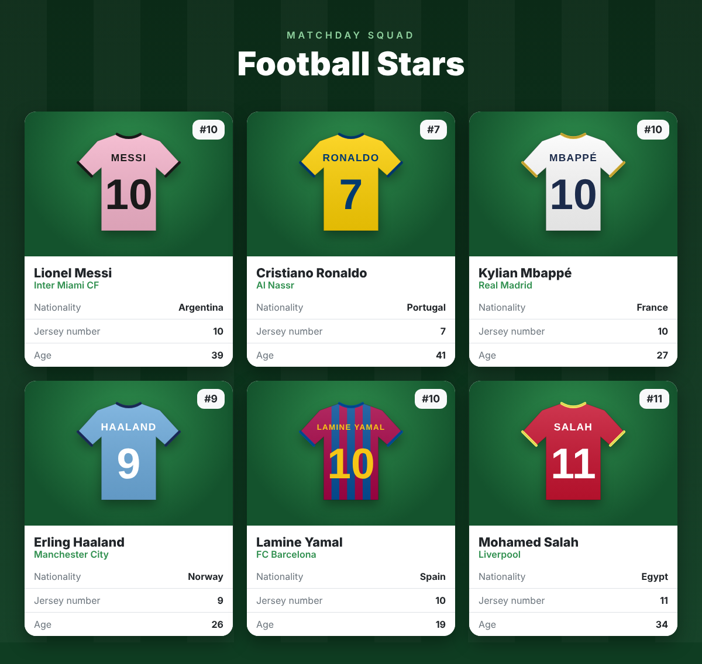

# Football Stars

A React + Vite project that shows football players as Bootstrap cards (via react-bootstrap).



## Files

- `src/players.js` – array of player objects (name, team, nationality, jerseyNumber, age, image)
- `src/components/Player.jsx` – the Player card; destructures every attribute with a default value
- `src/components/PlayersList.jsx` – maps over the players and passes props to `Player`
- `src/App.jsx` – root component that renders `PlayersList`
- `public/players/` – jersey images used for each player

## Run it

```
npm install
npm run dev
```

Then open the address shown in the terminal (usually http://localhost:5173).
